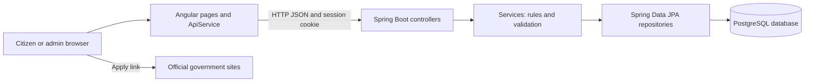
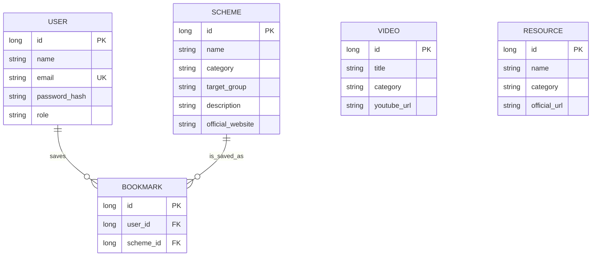

# Jan Sahayak: Project Explanation

This guide explains the project in plain language: what each part does, how a browser action reaches the database, why the main technologies and folders are used, and what to know when presenting or deploying the application.

## 1. What the project does

Jan Sahayak is a website for discovering Indian government welfare schemes and helpful official links. A visitor can browse schemes, search and filter them, read scheme details, and open official application pages. A citizen can create an account, sign in, and save schemes. An administrator can sign in separately and manage schemes, videos, and resources.

The site does not itself decide whether someone qualifies for a government scheme or submit an application to a government service. It presents information and links; the citizen completes applications on the linked official government website.

## 2. The simplest mental model

Think of the application as two programs that communicate over HTTP:

- **Frontend:** the Angular application running in the browser. It draws pages, collects input, and calls the backend.
- **Backend:** the Spring Boot application running on a server. It checks requests, applies rules, reads or writes database records, and returns JSON.
- **Database:** PostgreSQL when deployed with the configured database environment variables. It stores the lasting records.
- **Browser storage:** `localStorage` stores a small local cache and the display copy of the current user's profile. It is not the production database or a trusted source of authorization.



A common request travels like this:

1. The citizen clicks a button or opens a page.
2. An Angular component calls a method in `ApiService`.
3. `HttpClient` sends an HTTP request to the backend.
4. Spring Security checks whether the request is public, requires a signed-in citizen, or requires an administrator.
5. A controller passes the work to a service.
6. The service uses a repository to query or change database records.
7. The backend returns JSON or an HTTP status.
8. Angular updates the visible page with the result.

## 3. Technology choices and why they are used

| Technology | What it does here | Why it fits this project |
| --- | --- | --- |
| Java 21 | Language for backend code | Mature, strongly typed, and commonly used for server applications. |
| Spring Boot | Starts and configures the backend web server | Reduces setup work and gives standard patterns for APIs, configuration, and dependency injection. |
| Spring Web | Provides REST controllers and HTTP request handling | Lets the frontend call understandable URLs such as `GET /api/schemes`. |
| Spring Data JPA | Connects Java entity classes to database tables | Generates common database operations from repository interfaces, so basic SQL plumbing is not repeated. |
| Hibernate | JPA implementation used by Spring Data JPA | Maps entity objects to relational database rows. |
| Spring Security | Checks login sessions and permissions | Protects management APIs on the server, not just by hiding buttons in the UI. |
| BCrypt | Password hashing algorithm used by the password encoder | Stores a one-way password hash rather than the original password. |
| PostgreSQL | Persistent hosted database | Keeps account, content, and bookmark records between server restarts. |
| Maven | Backend build and dependency tool | Downloads Java libraries, compiles code, runs tests, and creates the executable jar. |
| Angular | Frontend framework | Organizes pages and reusable services into components and routes. |
| TypeScript | Frontend programming language | Adds types to JavaScript so models and method contracts are clearer. |
| RxJS | Asynchronous data flow used by Angular `HttpClient` | Represents HTTP responses as observables that components can subscribe to. |
| Docker | Packages the backend and Java runtime | Gives Render a repeatable way to build and start the backend. |

The project uses a normal browser/server/database architecture. It does not use microservices: there is one Angular application, one Spring Boot backend, and one relational database.

## 4. Folder map

### At the project root

- `backend/`: Java, Spring Boot, database configuration, and backend Dockerfile.
- `frontend/`: Angular pages, styles, routes, and browser-side services.
- `README.md`: short setup and project overview.
- `PROJECT_EXPLANATION.md`: this longer learning guide.
- `VIVA_GUIDE.md`: presentation/revision notes.
- `.gitignore`: excludes generated files and local secret files from Git.

### Backend: `backend/src/main/java/com/jansahayak/`

- `JanSahayakApplication.java`: the Java `main` entry point. `@SpringBootApplication` asks Spring Boot to discover and configure the application.
- `config/`: application-wide setup such as security, CORS, and initial sample data.
- `controller/`: HTTP endpoints. Controllers translate requests into calls to service methods.
- `dto/`: small request/response objects used for API communication. DTO means Data Transfer Object.
- `entity/`: Java classes mapped to database tables.
- `exception/`: application-specific error types and error handling.
- `repository/`: database access interfaces.
- `service/`: business rules and database operations coordinated by repositories.

### Frontend: `frontend/src/app/`

- `app.ts`, `app.html`, `app.css`: main application shell, shared navigation, and shared styling.
- `app.routes.ts`: connects browser paths such as `/schemes` to page components.
- `app.config.ts`: registers Angular-wide services, HTTP, router, and interceptors.
- `models.ts`: TypeScript shapes for schemes, users, videos, resources, and statistics.
- `pages/`: page-level components and their templates.
- `services/api.service.ts`: one place for frontend HTTP calls, local cache reads/writes, and fallback content.
- `services/auth.guard.ts`: prevents navigation to citizen-only and admin-only pages when the browser session profile has the wrong role.
- `services/credentials.interceptor.ts`: attaches browser credentials to requests when configured in the app.

## 5. Backend layers: the four main roles

The backend separates web handling, rules, and storage. This separation makes the application easier to understand and change.

### Controller: receive web requests

For example, `SchemeController` maps routes under `/api`:

- `GET /api/schemes` lists schemes.
- `GET /api/schemes/{id}` loads one scheme.
- `GET /api/schemes/search?keyword=...` searches.
- `POST /api/schemes` creates a scheme.

A controller should mostly deal with HTTP details: URL, method, request body, and response status. It hands the application work to a service.

### Service: apply application rules

`SchemeService`, `BookmarkService`, and `AuthService` contain work such as finding a record, checking whether it exists, preventing duplicate bookmarks, hashing passwords, and saving records.

For example, `BookmarkService.saveBookmark` looks up the user and scheme, checks for an existing bookmark, and saves a `Bookmark` entity. The controller does not need to know how the repository performs the lookup.

### Repository: read and write database rows

A repository such as `SchemeRepository` extends `JpaRepository<Scheme, Long>`. That gives common operations such as `findAll`, `findById`, `save`, and `delete` without writing each query by hand.

Repository method names can describe queries. For example, `findByCategoryIgnoreCase` means “find schemes whose category matches without caring about upper/lower case.”

### Entity: describe a database record

An entity is a Java class that Hibernate maps to a relational database table.

Examples:

- `Scheme` maps to scheme information.
- `User` maps to registered accounts and their role.
- `Video` maps to video links and descriptions.
- `Resource` maps to government resource links.
- `Bookmark` links a user to a saved scheme.

`@Entity` marks a persistent class. `@Id` identifies its primary key. `@ManyToOne` describes a relationship to another table. `@Column` can set database column details.

## 6. Data model in plain language

The important relationships are:



A bookmark is a separate row connecting one user and one scheme. The database has a unique constraint on `(user_id, scheme_id)`, which prevents the same user from saving the same scheme twice. Videos and resources are independent records; they do not need a user relationship.

The entity relationships mean Java code can navigate between a bookmark and its user/scheme. `@JsonIgnore` on some back-references prevents JSON serialization from endlessly walking in circles (user -> bookmarks -> user -> bookmarks ...).

## 7. Frontend architecture

### Routes

`app.routes.ts` defines the page paths. Angular Router changes pages without reloading the whole website:

- `/`: home page
- `/schemes`: scheme list
- `/schemes/:id`: one scheme's details
- `/videos`: video list
- `/resources`: resource list
- `/login`: citizen login
- `/admin-login`: administrator login
- `/register`: citizen account creation
- `/saved`: saved schemes, protected by `citizenGuard`
- `/admin`: content dashboard, protected by `adminGuard`

The guards improve navigation and user experience. They are not the real security boundary: a person can edit local browser storage. The backend's Spring Security rules are the important protection for data-changing requests.

### Page components

A page component normally has three pieces:

- A TypeScript class containing state and event handlers.
- An HTML template describing what should be displayed.
- CSS styling for that page.

Angular templates use bindings to connect page state to HTML. For example, `[(ngModel)]="searchTerm"` keeps an input synchronized with a TypeScript property. `(click)="saveScheme(...)"` calls a method when the button is clicked. `*ngFor` repeats a section for each item.

### API service

`ApiService` centralizes network calls so each page does not have to construct URLs independently. A page calls `getSchemes()`, `login()`, or `addResource()` rather than directly managing low-level HTTP details.

Most public lists use local cached/fallback data so the interface can still show something when a network call fails. On success, remote data is written into `localStorage`. This improves demo resilience, but it also means cached data can be stale. For authoritative, current content, the backend database is the source of truth.

Administrator additions use backend POST requests and update local cache only after the backend responds successfully. They are intended to persist in the database, not merely in local storage.

## 8. Authentication and permissions

There are two login entry points, but accounts and roles are stored in the same users table.

### Citizen registration

1. The registration page sends name, email, and password to `POST /api/auth/register`.
2. `AuthService` checks that the email is not already registered.
3. It hashes the password with the configured password encoder.
4. It assigns the new account the `USER` role and saves it through `UserRepository`.
5. The user is sent to the citizen login page.

The public registration endpoint does not accept a role field. This is important: a visitor must not be able to register themselves as an administrator.

### Login

- Citizen login calls `POST /api/auth/login/user`.
- Admin login calls `POST /api/auth/login/admin`.
- `AuthService` checks the email and password against the database and verifies the required role.
- `AuthController` creates a Spring Security authentication and saves it in an HTTP session.
- The browser keeps the session cookie and sends it on later requests.

The frontend also stores a small user profile in `localStorage` so it can show a name and role in the navigation. That browser profile is for display and frontend routing only; Spring Security's server-side session is what authorizes backend requests.

### Permission summary

- Visitors: read schemes, videos, and resources.
- Citizens: visitor actions plus account registration, login, logout, and their own bookmarks.
- Administrators: read content, access dashboard statistics, and create/update/delete schemes, videos, and resources.

Security rules are in `SecurityConfig`. In general it allows public GET requests for content, requires `ADMIN` for content-management methods and dashboard statistics, and requires a signed-in account for bookmark APIs. `BookmarkController` also checks that the authenticated email matches the user ID in the bookmark request.

There is one current limitation to be aware of: `DELETE /api/bookmarks/{id}` is available to administrators and deletes by bookmark ID. The citizen-facing delete route (`DELETE /api/bookmarks/user/{userId}/scheme/{schemeId}`) checks account ownership. Also, `SecurityConfig` currently disables CSRF protection. This is a simplification for the project, but cookie-authenticated deployments should review CSRF protection before treating the service as production-secure.

## 9. Example request walkthrough: browse schemes

When a visitor opens `/schemes`:

1. Angular Router creates `SchemesPageComponent`.
2. The page displays its local cached list first when available.
3. The component calls `ApiService.getSchemes()`.
4. `HttpClient` sends `GET /api/schemes`.
5. `SecurityConfig` sees that this is a public GET and allows it.
6. `SchemeController.getAllSchemes()` calls `SchemeService`.
7. The service asks `SchemeRepository` for all scheme rows.
8. Spring serializes the returned entities to JSON.
9. Angular stores the response in local cache and updates the displayed list.
10. Search/category filters operate on the page's list and do not require a separate database request for each keystroke.

## 10. Example request walkthrough: admin adds a resource

1. The administrator signs in through `/admin-login`.
2. The server validates the account's saved role and password and creates an authenticated session.
3. The administrator fills the resource form on `/admin`.
4. `AdminPageComponent.submitResource()` calls `ApiService.addResource()`.
5. The service sends `POST /api/resources` with the session cookie.
6. `SecurityConfig` requires the `ADMIN` role for POST requests to resource endpoints.
7. `ResourceController` calls `ResourceService`, which saves through `ResourceRepository`.
8. The API returns the created resource. Only then does the frontend update the browser cache and clear the form.

If a citizen attempts that POST directly, the backend should reject the request even if they bypass the Angular UI.

## 11. Database, configuration, and deployment

### Local and hosted data

The current `application.properties` expects PostgreSQL environment variables for the database URL, username, and password. The actual values should not be written into Java source, the Dockerfile, or a committed environment file. On Render, set them in the backend service's Environment settings.

Typical database variables include:

- `DB_URL`: JDBC connection URL supplied for the PostgreSQL database.
- `DB_USERNAME`: database username.
- `DB_PASSWORD`: database password; treat as a secret.
- `DB_DRIVER`: PostgreSQL driver class when explicitly configured.
- `DB_DIALECT`: Hibernate's PostgreSQL dialect when explicitly configured.
- `ADMIN_EMAIL` and `ADMIN_PASSWORD`: optional first-admin provisioning values.
- `FRONTEND_ORIGIN`: allowed frontend website origin for cross-origin browser requests.
- `PORT`: Render's web-service port; Spring reads it through `${PORT:8081}`.

The backend Dockerfile uses a build stage with Maven and Java 21, then copies the packaged jar into a smaller Java 21 runtime image. It runs the service as a non-root user. Render should build from `backend/` because the Dockerfile and `pom.xml` are there.

The database setting `spring.jpa.hibernate.ddl-auto=update` lets Hibernate adjust tables for entity changes. This is convenient in a student project, but production teams often use explicit database migration tools so schema changes can be reviewed and rolled back safely.

The current repository configuration should be checked before assuming H2 is available: the active `application.properties` expects PostgreSQL environment variables. If those variables are missing, startup may fail rather than silently selecting an in-memory database. The tests can still use a test-specific database configuration where supplied.

### Important deployment check

Inspect `backend/src/main/resources/application.properties` before deploying. At the time this guide was written, the `app.frontend.origin` value appeared malformed in the file snapshot. A malformed property can prevent the intended CORS origin from being set. Use a plain property such as:

```properties
app.frontend.origin=${FRONTEND_ORIGIN:http://localhost:4200}
```

Use the actual deployed frontend origin in Render's `FRONTEND_ORIGIN` environment setting. Do not place the database password in this file.

The frontend currently selects its local backend URL for `localhost`/`127.0.0.1`, and a fixed Render backend URL for other hostnames. If the Render backend URL changes, update the frontend's `ApiService.baseUrl` or move to an environment-based frontend configuration.

## 12. Tests and what they prove

Backend tests live under `backend/src/test/java/`:

- `JanSahayakApplicationTests`: checks that the Spring application test context can start.
- `SchemeDataIntegrityTest`: checks that a scheme object can hold its extended information fields.
- `BookmarkServiceTest`: checks bookmark-removal service behavior with mocked repositories.
- `RoleAuthorizationTest`: checks that unauthenticated and citizen requests cannot create resources.

A passing test suite is useful evidence, but it does not prove every browser workflow or every deployment environment is correct. The Angular production build checks TypeScript templates and compilation. A full deployment still requires testing with real Render environment variables and the actual PostgreSQL database.

## 13. Useful terms

- **API:** a set of URLs and rules that one program uses to communicate with another.
- **REST:** a common style for APIs using HTTP methods such as GET, POST, PUT, and DELETE.
- **JSON:** a text format used to send structured data between Angular and Spring.
- **HTTP status:** a number that summarizes a request result. `200` means success, `401` means authentication is missing/invalid, `403` means authenticated but not allowed, and `404` means the requested record or route was not found.
- **Dependency injection:** Spring creates shared objects and supplies them to classes that need them instead of each class constructing all dependencies itself.
- **ORM:** Object-relational mapping. Hibernate maps Java objects to relational database tables.
- **DTO:** Data Transfer Object, a small object for information crossing the API boundary.
- **Session cookie:** a browser-held identifier that lets the server recognize a signed-in session on later requests.
- **Fallback/cache:** a local copy used to keep a page usable if the API is unavailable; it is not automatically authoritative database content.

## 14. How to explain the project in a presentation

A short explanation could be:

> Jan Sahayak is a citizen welfare information portal. The Angular frontend displays the pages and sends JSON requests to a Spring Boot REST API. The backend uses controllers for HTTP routes, services for rules, repositories for database access, and JPA entities for stored records. PostgreSQL stores schemes, accounts, resources, videos, and bookmarks. Public users can browse; citizens can save schemes; administrators have server-enforced permission to manage content. The backend uses Spring Security sessions and BCrypt password hashing.

For a feature demonstration, browse a scheme, use its official application link, register and log in as a citizen to save it, then use a separately provisioned admin account to add a resource. Explain that actual scheme applications happen on government websites, not inside this portal.

## 15. Suggested reading order in the source

If you are learning the code, read these in order:

1. `backend/src/main/java/com/jansahayak/JanSahayakApplication.java` to see where Spring starts.
2. `frontend/src/app/app.routes.ts` to see which pages exist.
3. `frontend/src/app/pages/schemes-page.component.ts` to see one complete user-facing page.
4. `frontend/src/app/services/api.service.ts` to see how the frontend requests data.
5. `backend/src/main/java/com/jansahayak/controller/SchemeController.java` to find the matching API route.
6. `backend/src/main/java/com/jansahayak/service/SchemeService.java` to follow the application logic.
7. `backend/src/main/java/com/jansahayak/repository/SchemeRepository.java` to see database operations.
8. `backend/src/main/java/com/jansahayak/entity/Scheme.java` to understand the stored scheme fields.
9. `backend/src/main/java/com/jansahayak/config/SecurityConfig.java` to see backend permissions.
10. `backend/src/main/java/com/jansahayak/controller/AuthController.java` and `AuthService.java` to follow login and registration.
